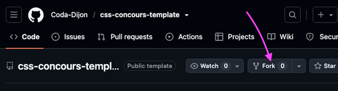

# css-concours-template

Point de départ du concours d'identité visuelle CSS.

Ton objectif : en groupe, changer **uniquement l'intérieur des déclarations CSS** pour adapter l'apparence à ton goût.

[Collection de badges](collection-de-badges)

## Consignes

### 1 - Créer un dépôt à partir de ce template

https://github.com/Coda-Dijon/css-concours-template


1. Use this template

2. Create fork
3. Un dépôt est créé sur ton espace personnel
4. Clone le dépôt sur ta machine

### 2 -  

Tu ne peux modifier que le fichier [collection-de-badges/style.css](collection-de-badges/style.css)

Pas le droit de modifier le fichier html.

Tu ne peux changer que l'intérieur des déclarations.

C'est à dire ce qui se trouve entre les `{` `}`.

Avec le point de départ suivant : 
```css
body {
    margin: 0;
    background-color: #f3f5f9;
    color: #20263a;
    font-family: "Times New Roman", serif;
    line-height: 1.5;
}
```

✅ Exemple valide : 
```css
body {
    /* Je peux ajouter ou modifier des propriétés et valeurs dans une déclaration existante */   
    margin: 0;
    background-color: #f3f5f9;
    color: #20263a;
    /* valeur de la police changée pour Arial */
    font-family: "Arial", sans-serif;
    line-height: 1.5;
    /* Propriété ajoutée */
    max-width: 60ch;
}
```


❌ Exemple invalide :

```css
body {
    margin: 0;
    background-color: #f3f5f9;
    color: #20263a;
    font-family: "Times New Roman", serif;
    line-height: 1.5;
}
/* On ne peut pas ajouter de nouvelle déclaration */
h1 {
    color: red;
}
```

## 3 - Présentation en groupe

Présenter ce que ton groupe avez fait pour améliorer l'identitié visuelle de la page.

